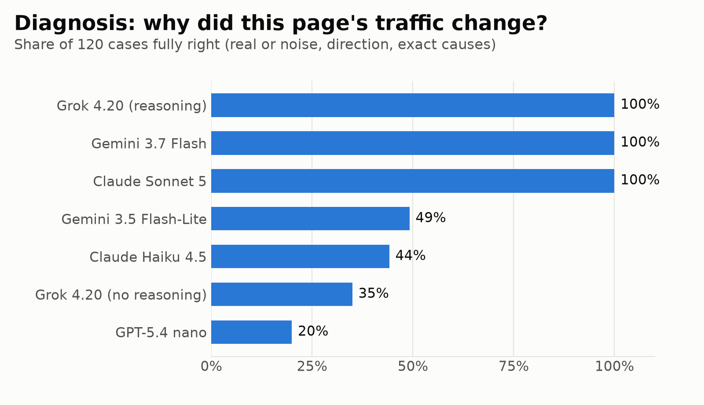
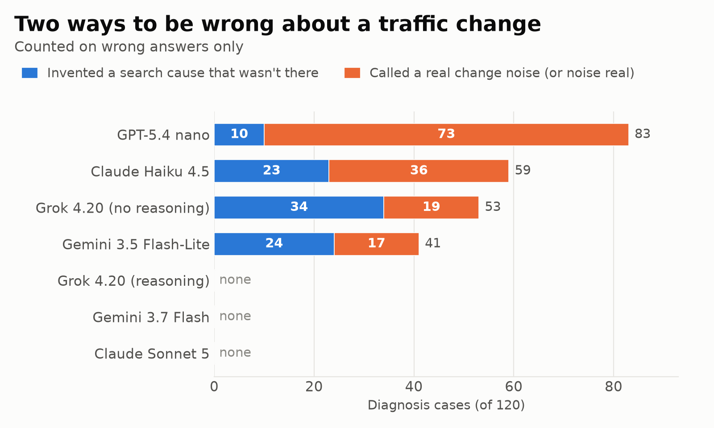
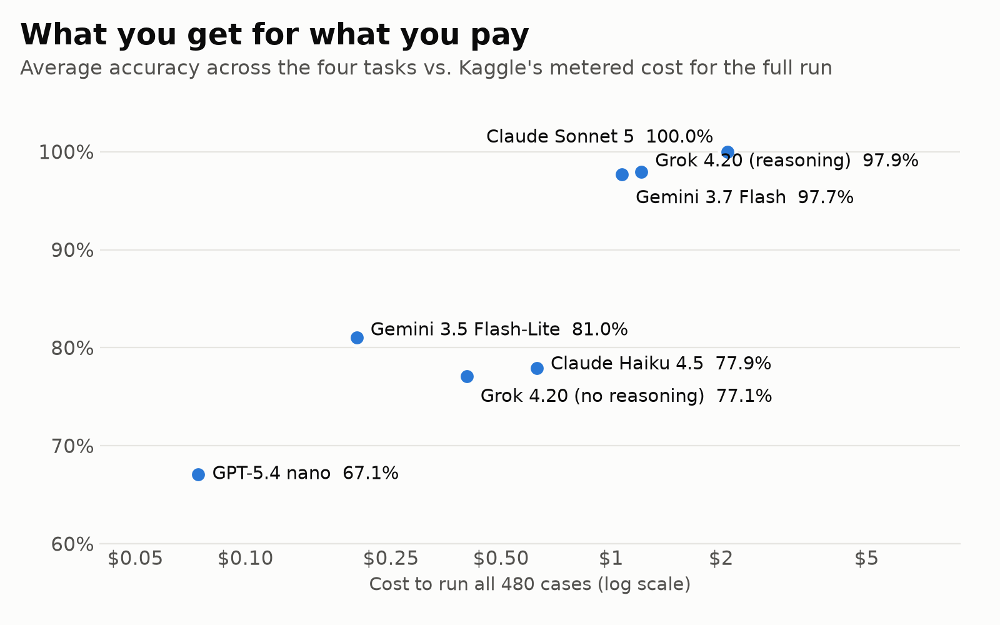

*This is a submission for the [Kaggle Benchmarking Challenge](https://dev.to/challenges/kaggle-2026-09-23)*

## What I Benchmarked

### The short version

I build [InsightTrack](https://github.com/NishikantaRay/InsightTrack), an open-source web analytics
platform. It has an AI analyst called **Pulse**. You ask *"why did traffic to /pricing drop last
week?"*, and Pulse picks the right tools, reads the numbers, and answers in plain English.

Pulse needs a language model behind it. I wanted to choose that model with evidence, not vibes, so I
turned Pulse's real job into a benchmark: **480 questions, graded automatically, with answers
that come from InsightTrack's own code.**

### The problem: an AI analyst can be confidently wrong

An analytics assistant isn't a chatbot for fun facts. People act on what it says: they rewrite pages,
pause campaigns, or stop worrying. When it's wrong, it's wrong in one of two costly ways:

1. **It invents a reason.** Traffic moves for a boring reason (a holiday, a newsletter, plain noise), and the assistant confidently blames Google rankings. You spend a day fixing SEO that was never broken.
2. **It misses a real problem.** Traffic falls by half, and the assistant says "nothing significant happened". You find out a month later.

Both are worse than saying "I don't know". A useful analyst needs three habits that don't show up on
general AI leaderboards:

- **Restraint:** saying "this is noise" or "the data doesn't show that" when that's the truth.
- **Rule-following on numbers:** applying thresholds exactly. A 15% change on 6 visitors is not a trend.
- **Reading real tool output:** the exact fields, rounding and formats a product actually returns, not textbook examples.

### Why general benchmarks don't answer this

Public benchmarks are excellent at telling you which model knows more maths, writes better code, or
calls functions correctly. But choosing a model for a product is a **product decision**, and it has
three questions they can't answer for you:

- **Accuracy on *my* job:** my tools, my data formats, my database dialect (DuckDB, not PostgreSQL).
- **The kind of mistakes:** a model that is wrong 10% of the time by saying "not sure" is safer than one that is wrong 5% of the time by making things up.
- **Cost:** is the expensive model worth it, or does a model at a tenth of the price do the same job?

The only way to answer those is to test models on the actual work. That's what this benchmark does.

### What's in it

**InsightTrack Analyst Bench** has 480 auto-graded cases across four tasks. The first three are Pulse's job today; the fourth, SQL, is the step Pulse doesn't take yet: writing a query when no built-in tool fits.

| Task | What Pulse must do | The model gets | It's right when |
|---|---|---|---|
| **Tool choice** | Decide how to answer | A user question + InsightTrack's real 23-tool catalogue | It picks the right tool and arguments, or says "none" when no tool can do it |
| **Data reading** | Understand a result | A tool result in InsightTrack's real output format | It gets the number right, or says `not_available` instead of inventing one |
| **Diagnosis** | Explain a change | 8 weeks of page traffic + Google results before and after | It says whether the change is real, which way it went, and the **exact** set of causes |
| **SQL** | Dig deeper (next on Pulse's roadmap) | InsightTrack's DuckDB `events` and `sessions` tables | Its query, *executed* read-only, returns the right rows |

Each task has **80 standard + 40 hard** cases. The hard ones are where careless reasoning shows:
- changes that land exactly on a threshold (a 15.0% drop)
- several keywords pointing in different directions
- pages that stopped ranking entirely
- lookalike domains: `getsite.com` is a different site, but `www.site.com` is yours

### One case, step by step

Here's what a diagnosis question looks like, simplified:

- **Weekly pageviews:** `… 495, 517, 347`. The last week dropped by 170 views, or 33%.
- **Google, before:** the page ranked **#3** for its keyword.
- **Google, now:** it ranks **#5**. Nothing else changed.
- **The rules** are all in the prompt. A change counts only if it's at least 15% **and** at least 20 views. A 1–2 place rank move is normal jitter, never a cause.

The correct answer: **the drop is real, but search didn't cause it.** In InsightTrack's terms,
`{"significant": true, "direction": "drop", "causes": ["unexplained_by_serp"]}`. The tempting wrong
answer is "your rank dropped". A model that says that sends the user to fix SEO that isn't broken.

That's the heart of the benchmark: **can the model tell a real cause from a coincidence?**

### Why the answers can be trusted

No LLM grades another LLM:
- **Diagnosis:** the answer key is InsightTrack's own correlation engine, ported to Python. A test runs the **original JavaScript** on every case plus 1,500 random ones and fails on any disagreement.
- **SQL:** answers are graded by *executing* the model's query, so two different but correct queries both pass.
- **Everything else:** answers are computed from the same data the model sees.
- **Data:** all synthetic (5,940 events, 2,494 sessions), with no real person's data, and the whole set rebuilds byte-for-byte.

Every grader also labels **how** a model was wrong: *invented a cause*, *called a real change noise*,
*made up a number*, *refused an answerable question*, *used a tool that doesn't exist*. That turns a
score into something you can act on.

### Who this helps

- **Developers building AI features on analytics or BI data.** You face the same choice I did. These results, and the failure types above, show what to expect from each class of model.
- **Anyone picking a model on a budget.** The results put a price on accuracy: where paying more buys a lot, and where it buys nothing.
- **People who build and evaluate models.** Most tests reward knowing things. This one rewards *not* claiming things, which is harder to measure and matters in real products.
- **InsightTrack's users.** Pulse gets its model and its safety checks from evidence instead of guesswork.

## Models Tested

All models ran through Kaggle's model proxy on the same task version. I picked them in pairs, so each
comparison answers a practical question:

- **Frontier vs. cheap, same company:** Claude Sonnet 5 vs. Claude Haiku 4.5, and Gemini 3.7 Flash vs. Gemini 3.5 Flash-Lite. *How much do you lose by saving money?*
- **Reasoning on vs. off, same model:** Grok 4.20 with and without reasoning. *Does "thinking" change the answer?*
- **The cheapest option:** GPT-5.4 nano. *Is "good enough" good enough?*
- **OpenAI's flagship:** GPT-5.5, as a reference point.

## Findings

| Model | Tool choice | Data reading | Diagnosis | SQL | **Overall** | Cost (480 cases) |
|---|---|---|---|---|---|---|
| Claude Sonnet 5 | 100 | 100 | 100 | 100 | **100.0** | $2.08 |
| Grok 4.20 (reasoning) | 100 | 96.7 | 100 | 95.0 | **97.9** | $1.21 |
| Gemini 3.7 Flash | 100 | 100 | 100 | 90.8 | **97.7** | $1.07 |
| Gemini 3.5 Flash-Lite | 98.3 | 88.3 | 49.2 | 88.3 | **81.0** | $0.20 |
| Claude Haiku 4.5 | 98.3 | 82.5 | 44.2 | 86.7 | **77.9** | $0.63 |
| Grok 4.20 (no reasoning) | 98.3 | 82.5 | 35.0 | 92.5 | **77.1** | $0.40 |
| GPT-5.4 nano | 93.3 | 61.7 | 20.0 | 93.3 | **67.1** | $0.07 |

**GPT-5.5** scored 100 on tool choice, 100 on data reading and **90.8 on diagnosis**. Of the expensive
models, it's the only one below 100% on diagnosis. It sits in its own line because Kaggle's daily model
budget ran out before its SQL run.

### 1. Tool choice is solved. Diagnosis is where models split.

Every model picked the right tool at least 93% of the time. So "can it call tools?" is no longer the
interesting question for an analytics assistant. The real question is whether it understands what the
numbers *mean*. On diagnosis, the top three models score 100%, and every cheaper model scores between
20% and 49%.



### 2. Same model, reasoning on vs. off: 100% vs. 35%

Grok 4.20 with reasoning got **every** diagnosis case right. The same model without reasoning got
**35%**. It lost all 16 multi-cause cases, and 9 of the 12 decoys. Nothing else in the results moved this
much. If your assistant answers "why did X change?", reasoning isn't a nice-to-have.

### 3. Cheap models fail in two opposite ways



**The alarmist.** Without reasoning, Grok invented a search cause 34 times. In one case, traffic
*rose* from 437 to 538 views while the page slipped from #3 to #5 on Google. The prompt says plainly
that a 1–2 place move is normal jitter and never a cause. Grok answered:

```json
{"significant": true, "direction": "spike", "causes": ["rank_drop"]}
```

It blamed a rank *drop* for a traffic *rise*. The right answer was `unexplained_by_serp`: this change
didn't come from search.

**The shrugger.** GPT-5.4 nano went the other way, calling real changes noise 73 times. A page fell
from **209 to 110 views (−47%)** right after sliding from #14 to #26 on Google. Nano answered:

```json
{"significant": false, "direction": null, "causes": []}
```

For an analytics product, this is the dangerous one. An alarmist wastes your afternoon. A shrugger
tells you everything is fine while your traffic halves.

### 4. Mixed signals break every cheaper model: 0 of 8

In the hard cases, one keyword lost rank while another *gained*, and traffic fell. The correct answer
names only the loss, since a gain can't explain a drop. Flash-Lite, Haiku, Grok without reasoning, and
nano **all scored 0 out of 8**. Haiku, for instance, blamed the drop on `ai_citation_gained`, a rule the
prompt says applies only when traffic rises. Real pages rank for many keywords at once, so this is
the everyday case, not an edge case.

### 5. Reading data: the cheaper models refuse and invent

On data reading, all 7 models correctly said `not_available` on the 24 standard questions the data
couldn't answer. The traps in the hard set split them:
- **Made-up numbers:** asked for the total unique visitors across a list of pages (impossible, because the same person can visit several pages), nano confidently answered **9,149**.
- **Refused answerable questions:** nano did this 13 times, and the other cheaper models 5–7 times each. They answered "not available" when the answer took one calculation.

A model that can't tell "I can't compute this" from "this can't be computed" isn't safe in either direction.

### 6. The SQL failures were habits, not logic

**Gemini 3.7 Flash scored 0/7 on JSON questions**, and nearly everything else it got right. Every time,
it wrote:

```sql
WHERE properties->>'name' = 'signup'
```

That's fine in PostgreSQL. In DuckDB, `->>` binds more loosely than `=`, so it parses as
`properties ->> ('name' = 'signup')` and crashes. One pair of parentheses fixes it. It looks like a
habit carried over from PostgreSQL, which is far more common in examples than DuckDB.

**Claude Haiku corrects itself mid-answer.** In 9 SQL replies it wrote a query, then *"Wait, let me
reconsider…"*, then a second query. The prompt asks for the query only, so the grader takes the first
one. In 8 of those 9 cases, the second query was right. Graded on its last query, Haiku's SQL score would
be 93.3% instead of 86.7%. That's a real cost of thinking out loud inside a tool call: whatever sits
between your model and your database reads the first answer.

### 7. Value: Gemini 3.7 Flash is the sweet spot



Gemini 3.7 Flash reaches 97.7% at about half the cost of Claude Sonnet 5. Below the top three there's a
cliff: no model under $0.65 per run scored above 81%, and all of them fell apart on diagnosis.

### So what will power Pulse?

**Gemini 3.7 Flash by default.** It scored 100% on the three tasks that are about judgement, at half the
price of the most accurate model. Its one weakness is fixable in code: wrap `->>` comparisons in
parentheses before running any generated SQL.

**Claude Sonnet 5 as the fallback** for anything SQL-heavy, since it was perfect everywhere.

**No cheaper model for diagnosis.** An assistant that shrugs at a 47% drop costs more than it saves.

The benchmark also backed a design choice InsightTrack already makes. In the product, Pulse's
`explain_traffic_change` tool works out significance and causes **in code**, and the model only
explains the result in plain English. These results show why: left to do that reasoning alone, every
cheaper model got it wrong at least half the time.

### What this means if you're building an AI assistant

These lessons carry over to any assistant that works with numbers:

1. **Compute, don't ask.** Anything with a threshold (significance, "is this a trend?") belongs in code. Let the model explain the result, not decide it.
2. **Make "nothing happened" and "I can't tell" valid answers, and test them.** If your tests only have cases with a cause, you'll never see the shrugger or the alarmist until a user does.
3. **Use reasoning where the answer is a *why*.** It was the biggest single factor in the results: 100% vs. 35% on the same model.
4. **Check generated SQL against your real database dialect.** Most failures here were PostgreSQL habits, not wrong logic, and a small rewrite or check catches them.
5. **Don't parse the first thing a model says.** Ask for a clean final answer, or read the *last* one, because models do correct themselves.
6. **Route by task.** Tool choice is cheap to get right, so a small model can handle it. Diagnosis isn't.

### What I'd measure next

- **Consistency:** run each model three times and count how often the same case flips.
- **Real tool calls:** multi-turn runs where the model actually calls InsightTrack's tools, instead of naming the one it would call.
- **Messier evidence:** seasonality, like a holiday dip that isn't search, alongside keywords that point in different directions.

### Limits, honestly

- **"Correct" means correct by InsightTrack's rules.** Every rule and threshold is written into the prompt, so this tests careful application, not guessing a hidden convention.
- **Synthetic data, one run per model**, all through Kaggle's model proxy.
- **SQL is graded strictly on the first query.** That costs Haiku, as described above.

## My Benchmark

**Kaggle benchmark:** https://www.kaggle.com/benchmarks/nishikantaray/insighttrack-analyst-bench

**Dataset (cases, sample tables, graders):** https://www.kaggle.com/datasets/nishikantaray/insighttrack-analyst-bench

**The product it's built from:** https://github.com/NishikantaRay/InsightTrack

### How you can use it

- **Test another model:** the four tasks are public on Kaggle, so anyone can run them against any model in Kaggle's catalogue and compare with the table above.
- **Reuse the method for your own product:** take a rule your code already enforces, turn it into generated test cases with the answer from your code, include cases where the right answer is "nothing", and label the *kind* of mistake as well as the score.

Built with [Kaggle Benchmarks](https://github.com/Kaggle/kaggle-benchmarks). The task pattern follows
its `dataset_evaluation.py` example. It covers ground near BFCL and τ-bench (tool calling),
InfiAgent-DABench and DSBench (data analysis), and Spider 2.0 and BIRD (text-to-SQL). It differs by
testing one real product's job end to end, and by scoring whether a model knows when *nothing* happened.
